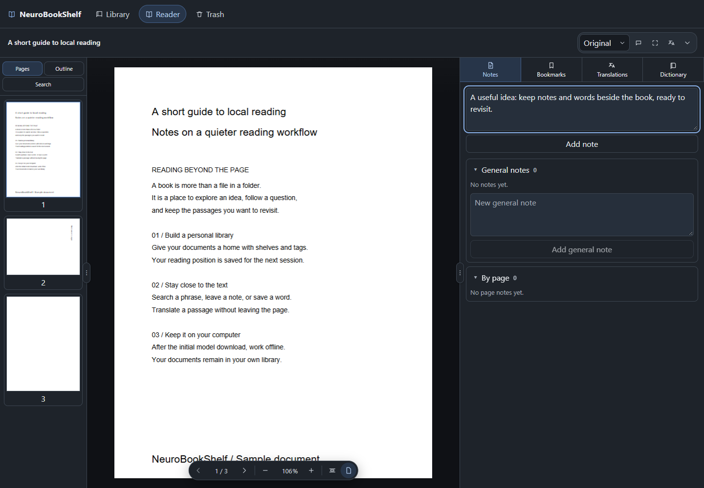

# NeuroBookShelf

**English** · [Русский](README.ru.md)

An offline PDF library with local OCR and translation. Organize books on shelves, find text, keep notes and translate pages without uploading your documents to a cloud service.

[](https://github.com/WalkingFrozenFish/NeuroBookShelf/releases/latest)
[](https://github.com/WalkingFrozenFish/NeuroBookShelf/actions/workflows/desktop.yml)
[](LICENSE)

**[Download the latest release](https://github.com/WalkingFrozenFish/NeuroBookShelf/releases/latest)** · [Report a bug or suggest a feature](https://github.com/WalkingFrozenFish/NeuroBookShelf/issues/new/choose) · [Changelog](CHANGELOG.md)



## What you can do

- **Organize:** import PDFs, use shelves and tags, search your catalog, export PDFs, trash and restore books.
- **Read:** thumbnails, PDF outline, zoom, saved reading position, text selection and copying, and in-book search with Ctrl+F.
- **Remember:** bookmarks, document and page notes, a book dictionary and a shared dictionary.
- **Translate locally:** translate a selected region or a page using the PDF text layer or local OCR. Review editable translation cards and saved versions.
- **Keep reading:** queue a page range for background translation, track progress, cancel and retry errors while navigating the app.
- **Take it with you:** the Windows portable edition keeps the library, runtime and models in its folder.

### Coming in the next release

The development version adds a Russian/English interface switch, a custom accent color picker, downloadable **English ↔ Russian** and **French ↔ English** translation models, automatic model routing, source/target selection and download cancellation. These changes are not yet included in the published **0.1.0** installer.

The stable 0.1.0 release translates **English → Russian**. OCR currently supports **English** in both versions. Other translation languages use the PDF's text layer; multilingual scan recognition is not included.

## Install

| Platform | Release asset | How to run |
| --- | --- | --- |
| Windows x64 | `*-setup.exe` | Run the installer |
| Windows x64 portable | `*-windows-x64-portable.zip` | Extract and open `NeuroBookShelf.exe` |
| macOS Apple Silicon (M1 or newer) | `*_aarch64.dmg` | Drag the app to Applications |

Python and required libraries are included. End users do not need Git, Node.js, Rust or a separate Python installation. The Windows installer downloads WebView2 if necessary.

You can read PDFs immediately. Download about **199 MiB** of OCR and English → Russian models when needed. In the development version, open **Settings → Models**, choose source and target languages and download the required pairs from the table. The app chooses installed models for each fragment. Once models are installed, reading, OCR and translation work offline. Your PDFs are not uploaded.

Windows builds currently have no publisher certificate. macOS uses an ad-hoc signature without notarization. Your system may warn or block the first launch. Intel Macs and ready to use Linux packages are not supported yet. See [installation details](DISTRIBUTION.en.md).

## Appearance and languages

In the development version, **Settings → Appearance** offers Russian/English interface language, light/dark modes, preset palettes and a custom color picker. The chosen color supplies the primary hue; the app adjusts brightness for each mode. Interface language and translation model are independent preferences.

PDF appearance has separate **Original**, **Dimmed** and **Night** modes. Night mode also darkens white regions in scans and changes illustration colors. The original PDF and exported copies remain unchanged.

## Your data

The regular installation stores PDFs, SQLite and models in the application data folder:

- Windows: `%APPDATA%/com.locallibrary.reader/`.
- macOS: `~/Library/Application Support/com.locallibrary.reader/`.
- Windows portable: `user-data/` next to the EXE.

Import stores a copy and leaves the original intact. Updates retain the library directory. To back up, close the app and copy the entire data directory. To move the portable edition, copy the entire extracted folder, including `runtime/`, `portable.flag` and `user-data/`.

## Current limitations

This is an early **0.x** project.

- PDF only; EPUB, MOBI and comics are not supported.
- Search and selection use an existing text layer. Scans are not OCR indexed for library search.
- Background queues do not survive an app restart. Saved translations remain; repeated jobs skip translated regions.
- OCR and translation may be inaccurate on complex layouts, tables, multiple columns or low quality scans.
- Partial text layers are not automatically supplemented with OCR. Dictionary entries do not customize the translation model.

## Development

React, TypeScript, Vite, Tauri/Rust, SQLite, PDF.js and a Python worker with PyMuPDF, PaddleOCR, CTranslate2 and SentencePiece.

Building requires Node.js 22, stable Rust, Tauri system dependencies and development Python 3.10–3.12. Packaged builds include their own Python. See [setup instructions (Russian)](SETUP.md).

```sh
git clone https://github.com/WalkingFrozenFish/NeuroBookShelf.git
cd NeuroBookShelf
npm ci
npm run tauri dev
```

Run `npm test`, `npm run build`, Python unit tests and Rust library tests before submitting a change. The workflow is **branch → PR → passing CI → squash merge**. The default branch is `master`; workflows also support `main`. Public releases are created separately by version tags.

The bilingual GitHub Pages landing source is in [`site/`](site/); [publishing instructions](docs/LANDING.md) explain enabling Pages. It has no framework or external scripts.

## Contributing and support

Use [GitHub Issues](https://github.com/WalkingFrozenFish/NeuroBookShelf/issues/new/choose) for bugs, ideas and questions. English and Russian are welcome. Describe what you expected, what happened, your platform and app version. Do not attach private PDFs or personal data to public reports.

[Contributing](CONTRIBUTING.en.md) · [Support](SUPPORT.en.md) · [Security](SECURITY.en.md) · [Architecture](ARCHITECTURE.md) · [Roadmap](ROADMAP.md) · [Release workflow](docs/WORKFLOW.md)

Maintained by [@WalkingFrozenFish](https://github.com/WalkingFrozenFish). Internal architecture, roadmap and build workflow documentation are currently in Russian.

## License

NeuroBookShelf source is licensed under [GNU AGPL v3](LICENSE), SPDX: `AGPL-3.0-only`. When distributing it, retain notices and provide corresponding source under the license terms. No warranty is provided.

Libraries, Python and model files retain their own licenses. See [third-party notices](THIRD_PARTY_NOTICES.md). Packaged builds include available license texts and a dependency inventory under `runtime/licenses/`.
