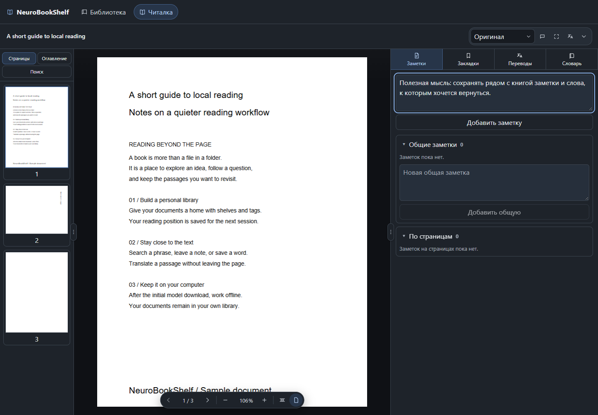

# NeuroBookShelf

[English](README.md) · **Русский**

Локальная PDF-библиотека с OCR и переводом. Храните книги на полках, ищите по тексту, оставляйте заметки и переводите страницы без облачных сервисов.

[](https://github.com/WalkingFrozenFish/NeuroBookShelf/releases/latest)
[](https://github.com/WalkingFrozenFish/NeuroBookShelf/actions/workflows/desktop.yml)
[](LICENSE)

**[Скачать приложение](https://github.com/WalkingFrozenFish/NeuroBookShelf/releases/latest)** · [Руководство](docs/GUIDE.md) · [Сообщить об ошибке](https://github.com/WalkingFrozenFish/NeuroBookShelf/issues/new/choose) · [История версий](CHANGELOG.md)



## Возможности

- **Библиотека:** импорт PDF с сохранением копии, полки, теги, поиск, экспорт, корзина и восстановление.
- **Читалка:** миниатюры, масштаб, запоминание позиции, оглавление PDF, выделение и копирование текста, поиск по книге через Ctrl+F.
- **Заметки:** закладки и заметки документа или страницы, словарь книги и общий словарь.
- **Перевод:** выделенная область или целая страница, текстовый слой PDF или локальный OCR, версии перевода и редактируемые карточки поверх страницы.
- **Фоновая очередь:** перевод диапазона страниц, прогресс, отмена и повтор ошибок; очередь продолжает работать при переходах между книгами.
- **Переносимость:** portable хранит библиотеку и модели рядом с приложением; всю папку можно перенести на другой компьютер.

### В следующем выпуске

В рабочей версии добавлены русский/English для интерфейса, свой основной цвет, загружаемые модели **English ↔ Russian** и **French ↔ English**, выбор исходного/целевого языка, автоматический подбор моделей и отмена загрузки. Настройки разделены на четыре вкладки, а корзина перенесена в левую панель библиотеки. Эти изменения пока не входят в опубликованный установщик **0.1.0**.

Стабильный выпуск 0.1.0 переводит **English → Russian**. OCR распознаёт **английский** в обеих версиях; другие языки переводятся из текстового слоя PDF. Многоязычного распознавания сканов пока нет.

## Установка

| Платформа | Файл в Release | Как запустить |
| --- | --- | --- |
| Windows x64 | `*-setup.exe` | Открыть установщик |
| Windows x64 portable | `*-windows-x64-portable.zip` | Распаковать и открыть `NeuroBookShelf.exe` |
| macOS Apple Silicon, M1 и новее | `*_aarch64.dmg` | Перенести приложение в Applications |

Python и библиотеки уже включены. Git, Node.js, Rust и ручная установка пакетов пользователю не нужны. Windows-установщик при необходимости скачает WebView2.

Читать PDF можно сразу. Для OCR и перевода English → Russian при необходимости загрузите около **199 МиБ** моделей. В рабочей версии откройте **«Настройки → OCR и перевод»**, выберите исходный/целевой языки и загрузите нужные пары из таблицы. Приложение подбирает установленные модели для каждого фрагмента. После установки моделей чтение, распознавание и перевод работают локально без сети. PDF не отправляются в облако.

Windows-сборка пока без сертификата издателя, а macOS использует тестовую ad-hoc подпись без нотарификации: система может предупреждать или блокировать первый запуск. Intel Mac и готовые Linux-пакеты пока не поддерживаются. Подробности — в [инструкции по установке](DISTRIBUTION.md).

## Оформление и языки

В рабочей версии **«Настройки»** находятся внизу левой панели библиотеки. Во вкладке **«Общие»** переключается русский/English, в **«Данных»** находятся хранение и сброс, в **«OCR и перевод»** — локальные модели, в **«Оформлении»** — светлый/тёмный режим, готовые палитры и свой цвет. Из выбранного цвета берётся основной оттенок, яркость подстраивается под режим. Язык интерфейса и направление перевода настраиваются независимо. Выбор сохраняется на этом компьютере.

Отображение PDF настраивается отдельно: «Оригинал», «Приглушённый» или «Ночной». Переключатель есть в настройках и в панели читалки. Приглушённый режим снижает яркость без инверсии, ночной затемняет также белые области внутри сканов и иллюстраций, но меняет их цвета. Страницы и миниатюры используют один режим; текстовый поиск, выделение и переводы остаются доступными. Исходный PDF и экспортируемая копия не изменяются.

## Быстрый старт и помощь

1. Импортируйте PDF и нажмите **«Читать»**. Добавьте полки или теги для организации книг.
2. Используйте **Ctrl+F** для поиска по тексту; сохраняйте закладки, заметки и слова в боковой панели читалки.
3. Установите локальные модели, когда потребуется OCR или перевод. В рабочей версии они доступны в **«Настройки → OCR и перевод»**.

[Руководство пользователя](docs/GUIDE.md) описывает библиотеку и корзину, настройки, модели, резервные копии и решение проблем. [Инструкция по установке](DISTRIBUTION.md) содержит требования платформ. Обе доступны на русском и английском.

## Данные и приватность

Обычная установка хранит PDF, SQLite и модели в каталоге данных приложения:

- Windows: `%APPDATA%/com.locallibrary.reader/`.
- macOS: `~/Library/Application Support/com.locallibrary.reader/`.
- Windows portable: `user-data/` рядом с EXE.

Импорт копирует документ и не меняет оригинал. Обновление приложения сохраняет каталог библиотеки. Для резервной копии закройте приложение и скопируйте весь каталог данных. Для переноса portable копируйте всю распакованную папку, включая `runtime/`, `portable.flag` и `user-data/`.

## Ограничения

Проект находится на ранней стадии, текущая ветка версий — 0.x.

- Читаются только PDF. EPUB, MOBI и комиксы пока не поддерживаются.
- Поиск и выделение используют существующий текстовый слой; OCR-индексации сканов пока нет.
- Фоновая очередь не восстанавливается после закрытия приложения. Сохранённые переводы остаются; повторная постановка пропускает готовые области.
- Качество OCR и перевода зависит от документа. Сложная вёрстка, таблицы, несколько колонок и некачественные сканы могут обрабатываться неточно.
- Страница с частичным текстовым слоем не дополняется OCR автоматически. Словарь не передаётся переводчику.

## Разработка

Стек: React 19, TypeScript, Vite, Tauri 2 / Rust, SQLite, PDF.js и Python worker с PyMuPDF, PaddleOCR, CTranslate2 и SentencePiece.

Для сборки нужны Node.js 22, Rust stable, системные зависимости Tauri и development Python 3.10–3.12. Пошаговая настройка — в [SETUP.md](SETUP.md).

```bash
git clone https://github.com/WalkingFrozenFish/NeuroBookShelf.git
cd NeuroBookShelf
npm ci
npm run tauri dev
```

Рабочий процесс: **ветка → PR → зелёный CI → squash merge → проверка основной ветки**. Публичный Release запускается отдельно тегом версии. Основная ветка — `master`, workflow также поддерживает `main`.

Инструкции для изменений и проверок: [CONTRIBUTING.md](CONTRIBUTING.md). Детали веток, CI и релизов: [docs/WORKFLOW.md](docs/WORKFLOW.md).

Исходники двуязычного лендинга GitHub Pages находятся в [`site/`](site/); [инструкция публикации](docs/LANDING.md) описывает включение Pages. Лендинг не использует фреймворки и внешние скрипты.

## Участие и поддержка

Используйте [GitHub Issues](https://github.com/WalkingFrozenFish/NeuroBookShelf/issues/new/choose) для ошибок, идей и вопросов. Русский и английский приветствуются. Опишите ожидаемое и фактическое поведение, систему и версию приложения. Не прикладывайте личные PDF или персональные данные к публичным обращениям.

[Участие](CONTRIBUTING.md) · [Поддержка](SUPPORT.md) · [Безопасность](SECURITY.md) · [Архитектура](ARCHITECTURE.md) · [Планы](ROADMAP.md) · [Процесс выпуска](docs/WORKFLOW.md)

Проект поддерживает [@WalkingFrozenFish](https://github.com/WalkingFrozenFish). Внутренняя документация об архитектуре, планах и процессе сборки пока ведётся на русском.

## Лицензия

Исходники NeuroBookShelf распространяются под [GNU AGPL v3](LICENSE), SPDX: `AGPL-3.0-only`. Использование, изменения и распространение разрешены на условиях этой лицензии; при распространении сохраняйте уведомления и предоставляйте соответствующие исходники. Гарантии не предоставляются.

Библиотеки, Python и модели сохраняют собственные лицензии. Источники и уведомления перечислены в [THIRD_PARTY_NOTICES.md](THIRD_PARTY_NOTICES.md), а сборка включает доступные тексты лицензий и инвентарь зависимостей в `runtime/licenses/`.
