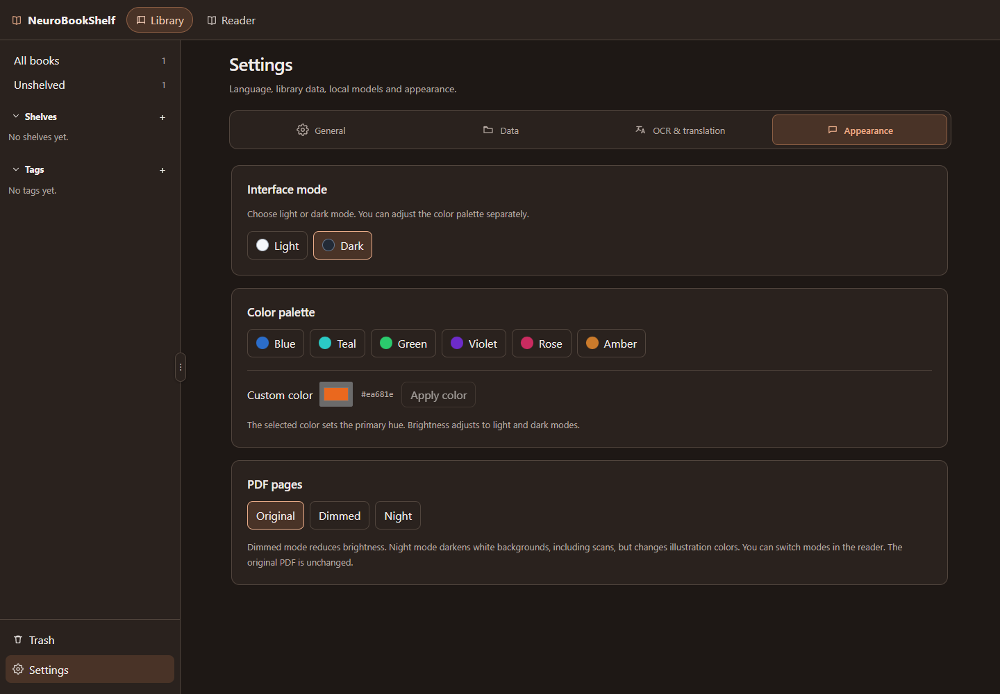

# User guide

**English** · [Русский](GUIDE.md) · [Project home](../README.md)

A guide to **NeuroBookShelf 0.2.0**: installation, reading, local models and data.

## Install and start reading

1. [Download a release](https://github.com/WalkingFrozenFish/NeuroBookShelf/releases/latest) for Windows x64 or macOS Apple Silicon. See the [installation guide](../DISTRIBUTION.en.md) for portable builds and first-launch troubleshooting.
2. Open the app and import a PDF into the library. Import keeps a copy; your original stays intact.
3. Open the book with **Read**. Models are optional for ordinary PDF reading.

## Library and trash

Use the left sidebar to browse all books, unshelved books or a particular shelf. Tags and catalog search help narrow the list. A book can belong to several shelves.

**Trash** is at the bottom of the library sidebar, above **Settings**. Moving a book there removes it from the regular library. Restore it from Trash to bring it back. Permanent removal requires confirmation; read the dialog before proceeding. Click **All books** or a shelf to return to the library.

## Reading, notes and words

The reader offers page thumbnails, a PDF outline when available, zoom and saved reading position. Use **Ctrl+F** to search the current PDF. Text selection and copying require an existing text layer; scanned pages are not automatically indexed.

Use the reader side panel for bookmarks, page or document notes, saved translations and the book dictionary. The shared dictionary collects words across books. Dictionary entries are a personal reference and do not change the translation model.

## Settings

Open **Settings** at the bottom of the library sidebar. The four tabs separate everyday preferences from data operations:

| Tab | Contents |
| --- | --- |
| General | Russian/English interface language and offline operation information |
| Data | Database location, opening its folder, moving the database, sample books and reset actions |
| OCR & translation | Local model status, language pairs, downloads and cancellation |
| Appearance | Light/dark interface, preset palette or custom color, PDF appearance |

The language switch takes effect immediately and is saved on this computer. It is independent of the source and target languages used for translation. Tabs also support Left/Right arrow keys, Home and End.

Choose a preset palette or select a custom color and press **Apply color**. The primary hue follows your selection; brightness adapts to light or dark mode. PDF **Original**, **Dimmed** and **Night** modes change display only. Night mode can alter illustration colors; exported PDFs keep their original appearance.

## Models, OCR and translation

1. Open **Settings → OCR & translation** while online. Download the OCR model if you need scanned English pages, and the translation pairs you need.
2. The catalog includes **English ↔ Russian** and **French ↔ English**. Choose source and target languages in the translation controls; automatic source detection is also available. The app selects installed models and can route via an intermediate language when the required pairs are installed.
3. Open a book and translate a selected region or a page. An existing PDF text layer is used when available. OCR currently recognizes **English only**; French and other supported translation languages require a text layer.
4. For several pages, add a page range to the background translation queue. You can keep reading, cancel a job or retry errors. The queue does not resume after an app restart; saved translations remain.

Downloads show progress and a **Cancel download** control. Completed model files are retained when cancelling. Switching settings tabs keeps the model panel and its download state alive. After installation, OCR and translation run locally without uploading your PDFs. Internet access is needed to obtain model files, not for inference.

## Data and backups

Normal installations store data in `%APPDATA%/com.locallibrary.reader/` on Windows or `~/Library/Application Support/com.locallibrary.reader/` on macOS. Portable Windows builds use `user-data/` beside the executable.

Close the app before making a backup. Copy the **entire data directory**, including PDFs, the database and models. For a portable move, copy the whole extracted application folder as well, including `runtime/` and `portable.flag`.

**Data → Move database…** copies the database and switches to the new copy; it does not move PDF files. If you use a custom database location, include that file in backups too. Resetting shelves or tags and clearing the library are separate operations with confirmation dialogs. Read their descriptions carefully before confirming.

## Troubleshooting

| Problem | What to check |
| --- | --- |
| Cannot select or find text | The PDF may be a scan. Use English OCR for translation; whole-library OCR indexing is not available. |
| Translation unavailable | Check installed language pairs, source/target choices and model status in settings. |
| Download interrupted | Check network access and free disk space, then retry the required models. |
| Poor OCR or translation | Complex columns, tables and low-resolution scans may be inaccurate. Review and edit saved translations. |
| System blocks first launch | Read the platform-specific steps in the installation guide; current builds are not publisher-signed/notarized. |

For other problems, [open an issue](https://github.com/WalkingFrozenFish/NeuroBookShelf/issues/new/choose) with your app version, operating system, steps to reproduce and the error text. Avoid posting private PDFs or personal information. See [Support](../SUPPORT.en.md).
