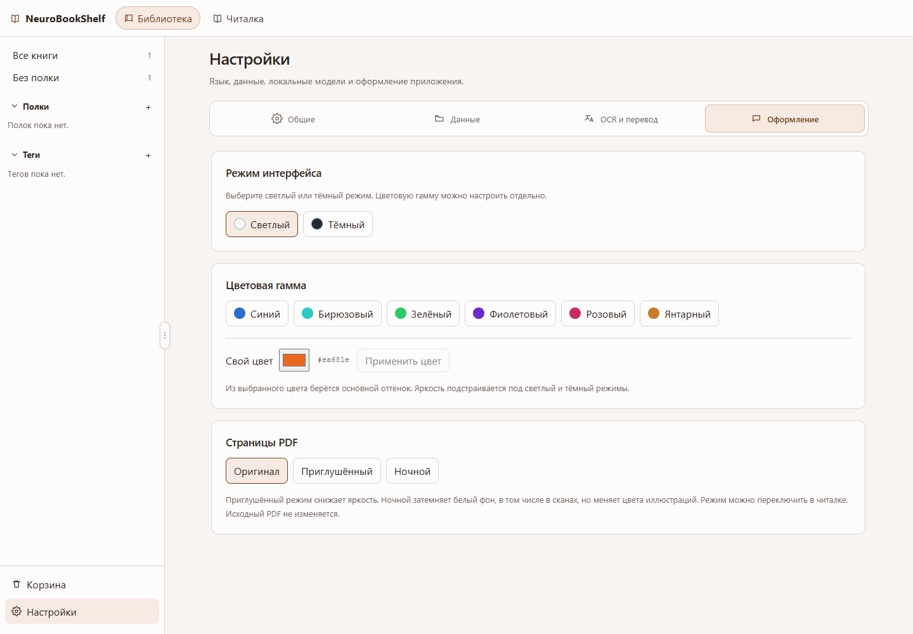

# Руководство пользователя

[English](GUIDE.en.md) · **Русский** · [Главная страница проекта](../README.ru.md)

Руководство для **NeuroBookShelf 0.2.0**: установка, чтение, локальные модели и данные.

## Установка и первое чтение

1. [Скачайте выпуск](https://github.com/WalkingFrozenFish/NeuroBookShelf/releases/latest) для Windows x64 или macOS Apple Silicon. Portable и особенности первого запуска описаны в [инструкции по установке](../DISTRIBUTION.md).
2. Запустите приложение и импортируйте PDF в библиотеку. При импорте сохраняется копия, оригинал остаётся на месте.
3. Откройте книгу кнопкой **«Читать»**. Для обычного чтения PDF модели не нужны.

## Библиотека и корзина

В левой панели доступны все книги, книги без полки и отдельные полки. Теги и поиск по каталогу помогают сузить список. Одна книга может находиться на нескольких полках.

**«Корзина»** расположена внизу левой панели библиотеки, над **«Настройками»**. Перемещённая туда книга исчезает из обычного списка. Восстановите её из корзины, чтобы вернуть в библиотеку. Окончательное удаление требует подтверждения: прочитайте диалог перед действием. Для возврата к книгам нажмите **«Все книги»** или выберите полку.

## Чтение, заметки и слова

В читалке есть миниатюры страниц, оглавление PDF при его наличии, масштаб и сохранение позиции. **Ctrl+F** открывает поиск по текущему PDF. Выделение и копирование требуют существующего текстового слоя; сканы автоматически не индексируются.

В боковой панели читалки доступны закладки, заметки страницы или документа, сохранённые переводы и словарь книги. Общий словарь собирает слова из разных книг. Записи словаря служат личной шпаргалкой и не меняют результат модели перевода.

## Настройки

Откройте **«Настройки»** внизу левой панели библиотеки. Четыре вкладки разделяют повседневные предпочтения и операции с данными:

| Вкладка | Содержание |
| --- | --- |
| Общие | Русский/English для интерфейса и сведения о локальной работе |
| Данные | Расположение базы, открытие папки, перенос базы, примеры книг и сброс данных |
| OCR и перевод | Состояние локальных моделей, языковые пары, загрузка и её отмена |
| Оформление | Светлый/тёмный интерфейс, готовая палитра или свой цвет, отображение PDF |

Язык меняется сразу и сохраняется на этом компьютере. Он не зависит от исходного и целевого языка перевода. Вкладки также переключаются стрелками влево/вправо, Home и End.

Выберите готовую палитру либо укажите свой цвет и нажмите **«Применить цвет»**. Приложение берёт из цвета основной оттенок, а яркость подстраивает под светлый или тёмный режим. Режимы PDF **«Оригинал»**, **«Приглушённый»** и **«Ночной»** меняют только отображение. Ночной режим может менять цвета иллюстраций; экспортируемые PDF сохраняют исходный вид.

## Модели, OCR и перевод

1. При доступном интернете откройте **«Настройки → OCR и перевод»**. Загрузите OCR для сканированных английских страниц и нужные пары перевода.
2. В каталоге есть **English ↔ Russian** и **French ↔ English**. Выберите исходный и целевой языки в элементах перевода; доступно и автоопределение исходного языка. Приложение подбирает установленные модели и может переводить через промежуточный язык при наличии нужных пар.
3. Откройте книгу и переведите выделенную область или страницу. Если у PDF есть текстовый слой, используется он. OCR пока распознаёт **только английский**; французский и другие поддерживаемые языки перевода требуют текстового слоя.
4. Для нескольких страниц добавьте диапазон в фоновую очередь перевода. Можно продолжать чтение, отменить задание или повторить ошибки. Очередь не восстанавливается после перезапуска приложения; сохранённые переводы остаются.

При загрузке видны прогресс и кнопка **«Отменить загрузку»**. Уже готовые файлы моделей при отмене сохраняются. Переключение вкладок настроек сохраняет панель моделей и состояние загрузки. После установки распознавание и перевод работают локально, PDF никуда не отправляются. Интернет нужен для получения файлов моделей, а не для обработки книг.

## Данные и резервные копии

Обычная установка хранит данные в `%APPDATA%/com.locallibrary.reader/` на Windows или `~/Library/Application Support/com.locallibrary.reader/` на macOS. Portable для Windows использует `user-data/` рядом с приложением.

Перед резервным копированием закройте приложение. Скопируйте **весь каталог данных**, включая PDF, базу и модели. Для переноса portable дополнительно копируйте всю распакованную папку приложения, включая `runtime/` и `portable.flag`.

Команда **«Данные → Перенести базу…»** копирует базу и переключает приложение на новую копию; PDF она не перемещает. Если база хранится отдельно, включите этот файл в резервную копию. Сброс полок, сброс тегов и очистка библиотеки — отдельные операции с подтверждением. Перед подтверждением внимательно прочитайте описание действия.

## Если что-то не работает

| Проблема | Что проверить |
| --- | --- |
| Текст не выделяется и не находится | Возможно, PDF — скан. Для перевода доступен английский OCR; индексации всей библиотеки через OCR пока нет. |
| Перевод недоступен | Проверьте установленные пары, исходный/целевой языки и состояние моделей в настройках. |
| Загрузка прервалась | Проверьте интернет и свободное место, затем повторите загрузку нужных моделей. |
| Плохое распознавание или перевод | Колонки, таблицы и нечёткие сканы могут обрабатываться неточно. Проверяйте и редактируйте сохранённые переводы. |
| Система блокирует первый запуск | Прочитайте раздел своей платформы в инструкции по установке: у сборок пока нет сертификата издателя/нотарификации. |

Для других проблем [создайте Issue](https://github.com/WalkingFrozenFish/NeuroBookShelf/issues/new/choose): укажите версию приложения, систему, шаги воспроизведения и текст ошибки. Не публикуйте личные PDF и персональные данные. Подробнее — в [разделе поддержки](../SUPPORT.md).
