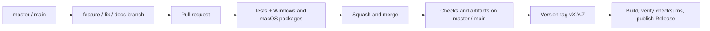

# Ветки, проверки и релизы

Основная ветка репозитория — `master`. `main` поддерживается тем же workflow на случай переименования. Долгоживущая ветка `develop` не используется.



## Что запускается

| Событие | Проверки | Установщики в Actions | Публичный Release |
| --- | --- | --- | --- |
| Push рабочей ветки без PR | Нет | Нет | Нет |
| Создание PR или новый commit в PR | Да | Windows + macOS | Нет |
| Merge / push в `master` или `main` | Да | Windows + macOS | Нет |
| Ручной запуск workflow | Да | Windows + macOS | Нет |
| Push тега `vX.Y.Z` из основной ветки | Да | Windows + macOS | После всех проверок |

Проверки PR выполняются для результата его объединения с целевой веткой. Старый прогон того же PR отменяется при новом commit. Push рабочей ветки отдельно не запускает вторую копию сборки. Теги не отменяют друг друга.

Итоговый status check **CI** проходит только после `checks` и обеих сборок `installers`. Именно `CI` используется для защиты основной ветки. Workflow запускается и для изменений документации: обязательная проверка не должна зависать из-за `paths-ignore`.

Сборочные задания имеют только `contents: read`. Секреты Apple используются только при сборке тега; код PR их не получает. Только `publish-release`, запускаемый для тега, имеет `contents: write`. Он скачивает артефакты своего workflow, проверяет SHA-256 всех трёх пакетов и публикует Release. При сбое сборки публикация не запускается; при сбое загрузки уже созданный релиз остаётся черновиком.

## Настройки GitHub

Рекомендуемые настройки для этого небольшого проекта:

- Merge через **Squash and merge**, заголовок PR становится сообщением коммита.
- Автоматическое удаление ветки после merge.
- Защита основной ветки: PR обязателен, status check `CI` обязателен, ветка должна быть актуальна относительно основной; force push и удаление запрещены.
- Обязательный сторонний approve не включается, пока сопровождающий один: автор не может одобрить собственный PR.
- CODEOWNERS указывает сопровождающего; наличие файла само по себе не включает обязательное одобрение.
- Dependabot создаёт сгруппированные PR для npm, Cargo и GitHub Actions. Python/OCR-стек обновляется согласованно вручную.

Эти настройки хранятся на GitHub, а не применяются автоматически из Markdown. Фактическое состояние и рекомендуемые значения фиксируются в `docs/REPOSITORY_SETTINGS.md`.

## Подготовка версии

1. Создайте ветку `chore/release-X.Y.Z` от актуального `master`.
2. Обновите версии в `package.json`, корневой записи и `packages[""]` файла `package-lock.json`, `src-tauri/tauri.conf.json`, `src-tauri/Cargo.toml` и записи `local-library-reader` в `src-tauri/Cargo.lock`.
3. Заполните `RELEASE_NOTES.md`: первая строка `# NeuroBookShelf X.Y.Z`, актуальные имена файлов, изменения и инструкции. Перенесите Unreleased в раздел новой версии `CHANGELOG.md`.
4. Выполните `python scripts/check_version.py vX.Y.Z`, создайте PR и дождитесь `CI`. Проверьте установку/обновление на целевых ОС, включая сохранение библиотеки.
5. После merge и зелёной сборки основной ветки:

```bash
git switch master
git pull --ff-only
git tag -a vX.Y.Z -m "NeuroBookShelf X.Y.Z"
git push origin vX.Y.Z
```

`X.Y.Z` заменяется реальным номером. Уже опубликованный `v0.1.0` повторно не создавайте. Существующие релизные теги не передвигаются; исправление выпускается новой patch-версией. Workflow поддерживает стабильные теги `vMAJOR.MINOR.PATCH`; prerelease-теги пока не публикуются этим процессом.

Тег должен указывать на commit, входящий в текущую основную ветку. Проверка не пропустит выпуск неслитой feature-ветки. Первый `v0.1.0` был выпущен из подготовительной ветки до введения этого правила; это историческое исключение, а не обычный процесс.

Не каждый merge создаёт новую версию. До 1.0 номера выбираются вручную: patch для совместимых исправлений, minor для новых возможностей или изменений совместимости, которые явно описываются в release notes.

## Если сборка или выпуск упали

Откройте Actions → Desktop installers → неудачный job. Исправление кода идёт обычным PR. Для временного сетевого сбоя можно повторить failed jobs; существующий черновик релиза будет дополнен. Опубликованные файлы не заменяйте исправленной сборкой под прежней версией: выпускайте следующий patch.

Установщики пока без Windows publisher certificate; macOS без Apple Developer ID использует ad-hoc подпись. Это не блокирует CI, но ограничения установки должны оставаться в release notes. Настройка подписи — в [DISTRIBUTION.md](../DISTRIBUTION.md).
